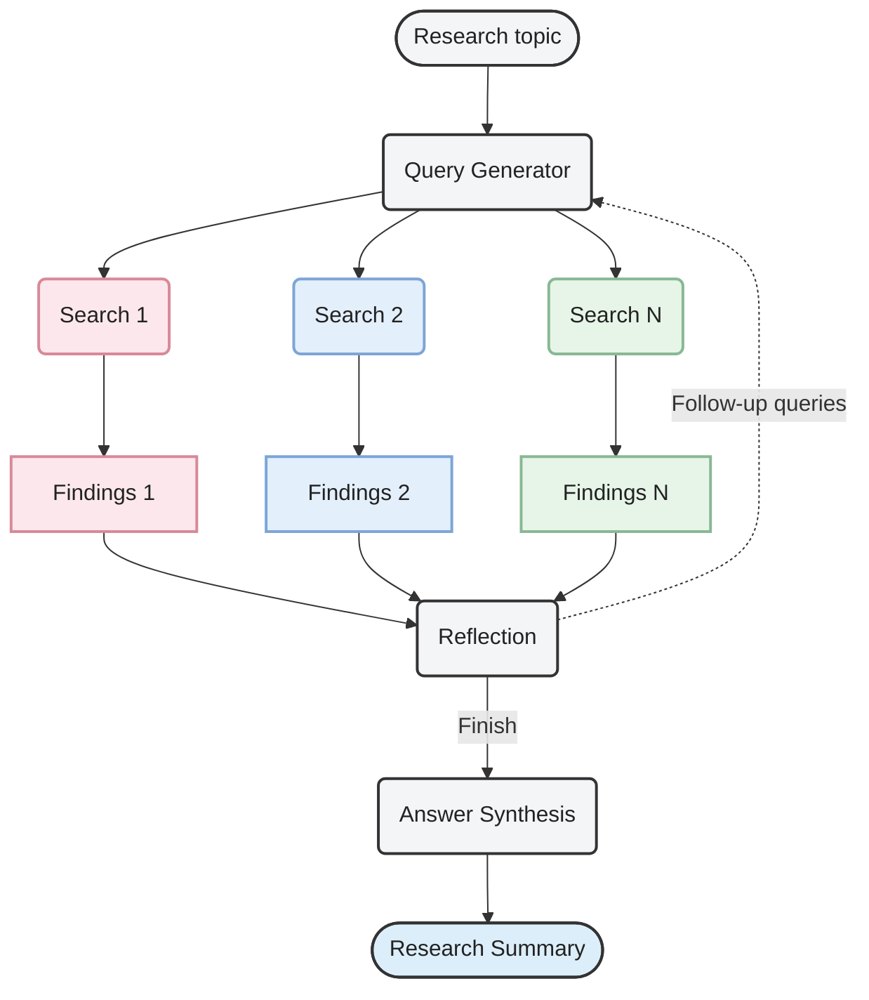
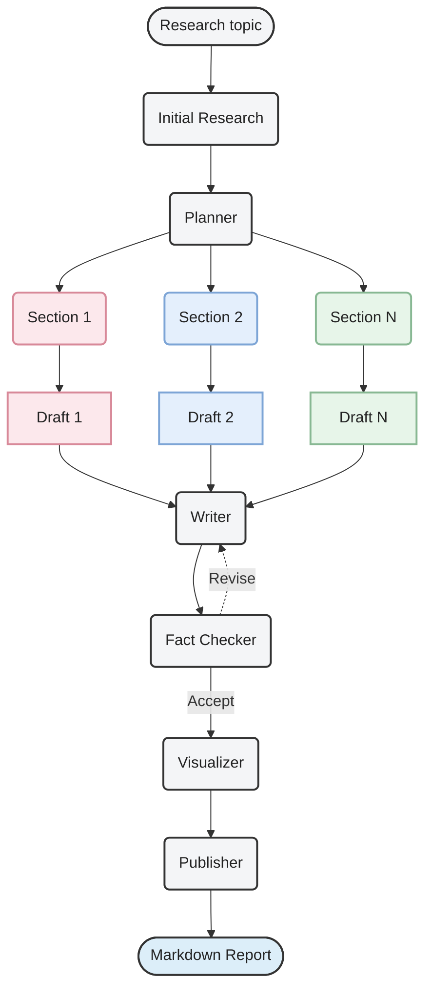

# Introduction

**Deep Researcher** is a multi-agent framework for in-depth research. It goes beyond a single LLM response by breaking a question into focused searches, gathering evidence, and coordinating a structured research and writing process.

The framework consists of two core components:

- **Researcher** generates search queries, runs web searches in parallel, evaluates the collected information, and identifies gaps that require further investigation. It then synthesizes the findings into research material for the report.
- **ChiefAgent** orchestrates the overall workflow. It plans the report structure, coordinates parallel research across sections, and manages draft review and revision. The workflow includes checks against the collected research and is designed to accommodate human feedback, with the aim of producing detailed, well-organized reports in a formal and objective style.

Together, these components aim to produce detailed, well-structured, and evidence-based research reports.


# Architecture


## Researcher Workflow



## ChiefAgent Workflow



# Quick Start

### Prerequisites

- Python 3.12
- Git
- A Gemini API key and access to a model that supports Google Search grounding and structured output

### 2. Create a virtual environment

**Windows (PowerShell)**

```powershell
py -3.12 -m venv .venv
.\.venv\Scripts\Activate.ps1
```

**macOS / Linux**

```bash
python3.12 -m venv .venv
source .venv/bin/activate
```

Then install the dependencies:

```bash
python -m pip install -r requirements.txt
```

The virtual environment is created locally and is excluded from Git by `.gitignore`. The frontend is served by FastAPI; no separate frontend build is required.

### 3. Configure the environment

Copy `.env.sample` to `.env` in the repository root:

**Windows (PowerShell)**

```powershell
Copy-Item .env.sample .env
```

**macOS / Linux**

```bash
cp .env.sample .env
```

Open `.env` and replace the placeholders with your credentials and model ID:

```dotenv
GEMINI_API_KEY=your_gemini_api_key
RESEARCH_MODEL_ID=your_available_gemini_model_id
```

Use a model available to your API account that supports both Google Search grounding and structured output. Enter the model ID without the `google_genai/` prefix. The application loads `.env` automatically. Do not commit your real API key; `.env` is already excluded by `.gitignore`.

### 4. Start the application

With the virtual environment still active, move to the parent directory and start the server:

```bash
cd ..
python -m uvicorn deep_researcher.backend.app:app --reload --host 127.0.0.1 --port 8000
```

Run this command from the directory **containing `deep_researcher/`**. The project uses package-relative imports, so running `python main.py` or launching `backend.app:app` directly from the repository root will not work.

Open [http://127.0.0.1:8000](http://127.0.0.1:8000), enter a topic, and click **Start research**. When the report is ready, use **Copy report** or **Download Markdown** to save it.

API documentation is available at [http://127.0.0.1:8000/docs](http://127.0.0.1:8000/docs). Press `Ctrl+C` to stop the server. Task state is held in memory and is cleared when the server restarts.

### Optional: Run the command-line example

From the same parent directory, with the virtual environment active:

```bash
python -m deep_researcher.main
```

This runs the example topic, **Explainable AI methods for spectroscopy**, and prints the final report in the terminal. Edit the `topic` field in `deep_researcher/main.py` to change the question.

Both entry points default to up to two report sections, one initial search query per Researcher run, and one search round per run. Human feedback is disabled. To adjust these settings, edit the `task` dictionary in `main.py` for the command-line example or in `run_agent()` in `backend/app.py` for the web application.
