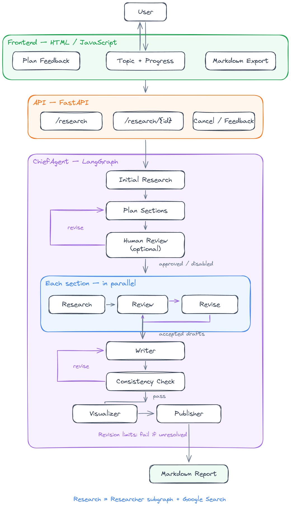
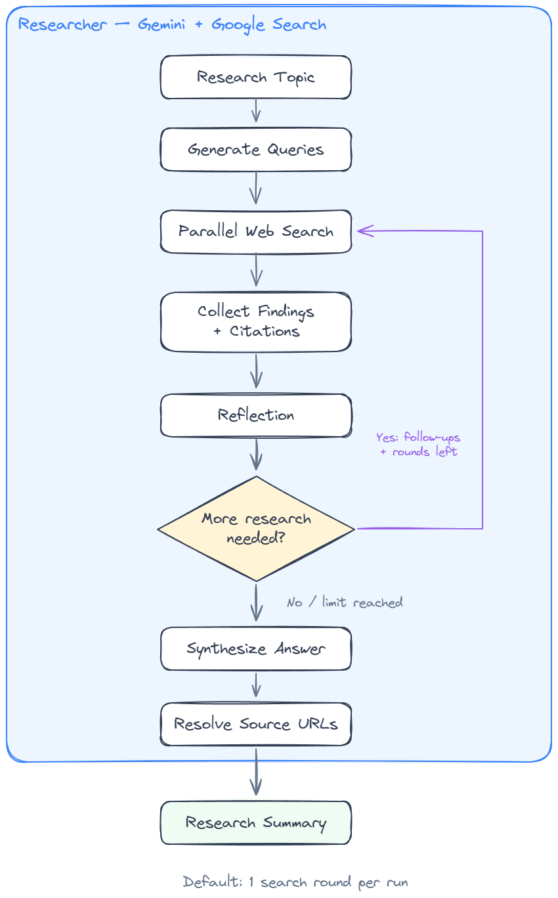

# Deep Researcher

A multi-agent research application built with LangGraph, Gemini and Google Search grounding. It turns a topic into a structured Markdown report by gathering sources, planning sections, researching them in parallel, reviewing drafts, and assembling the final report. A FastAPI backend serves the browser interface and manages research tasks.

## Table of Contents

- [Architecture Overview](#architecture-overview)
- [ChiefAgent Workflow](#chiefagent-workflow)
- [Researcher Subgraph](#researcher-subgraph)
- [Technology Stack](#technology-stack)
- [Project Structure](#project-structure)
- [Backend API Reference](#backend-api-reference)
- [Frontend](#frontend)
- [Configuration](#configuration)
- [Getting Started](#getting-started)

## Architecture Overview

The browser frontend submits a topic to FastAPI and polls for progress and the completed report. ChiefAgent coordinates the report workflow, while the reusable Researcher graph performs web research for the initial topic and individual sections. Gemini generates and reviews content; the Google GenAI SDK provides Google Search grounding.

<p align="center">
  
</p>


Task state is stored in memory in a single server process. Completed, failed and cancelled tasks become eligible for cleanup after one hour; cleanup runs every minute and defers removal while a WebSocket subscriber is connected. Restarting the server clears all task state.

## ChiefAgent Workflow

`multi_agents/orchestrator.py` defines the report workflow. Initial research informs a section plan. Each section then runs through its own research, review and revision loop before the report is assembled.


The draft-review loop runs separately for each section. Plan, draft and fact-check revisions each have a configurable limit; unresolved rejection at the limit fails the task.

**Agent responsibilities:**

| Agent | Purpose |
| :--- | :--- |
| `ResearcherAgent` | Run initial research and research individual report sections |
| `EditorAgent` | Plan sections and coordinate parallel section workflows |
| `HumanAgent` | Collect optional approval or feedback on the plan |
| `ReviewerAgent` | Review a section draft and return approval or revision instructions |
| `ReviserAgent` | Revise the full section draft using review feedback |
| `WriterAgent` | Produce the introduction, conclusion, table of contents and references |
| `FactCheckerAgent` | Check the Writer's introduction, conclusion and references against the supplied research |
| `VisualizerAgent` | Generate a Mermaid diagram when supported by the research |
| `PublisherAgent` | Combine the sections and supporting content into Markdown |

The fact checker performs a consistency check against collected research. It does not independently browse sources or verify the entire report against external ground truth. Publishing here means assembling the report returned to the user.

## Researcher Subgraph

`researcher/graph.py` implements a reusable search-and-reflection workflow. Generated queries are dispatched in parallel. Reflection identifies missing information and can send follow-up queries directly to web search.

<p align="center">
  
</p>


| Step | Responsibility |
| :--- | :--- |
| `generate_query` | Generate search queries using a structured output model |
| `web_search` | Call Gemini with Google Search grounding and collect cited findings |
| `reflection` | Assess evidence sufficiency and produce follow-up queries |
| `evaluate_research` | Continue searching or finish based on findings and the search-round limit |
| `finalize_answer` | Synthesize findings and resolve temporary citation identifiers to source URLs |

Responses without search sources are marked as unverified research material. Once the search-round limit is reached, the graph proceeds to synthesis even if reflection still identifies gaps.

## Technology Stack

| Layer | Technology | Purpose |
| :--- | :--- | :--- |
| Workflow engine | LangGraph | Report orchestration, research graphs and conditional revision loops |
| Model integration | LangChain Core, `langchain-google-genai` | Gemini calls and structured outputs |
| Search | Google GenAI SDK | Google Search grounding and citation metadata |
| Validation | Pydantic v2 | Configuration, API inputs and model response schemas |
| Backend | FastAPI, Starlette, Uvicorn | HTTP API, WebSocket endpoints and static frontend hosting |
| Concurrency | Python `asyncio` | Background tasks and parallel section research |
| Frontend | HTML, CSS, JavaScript | Topic submission, progress, feedback and report display |
| Diagrams | Mermaid 12.2.0 | Browser rendering of generated diagrams |
| Configuration | python-dotenv | Load local environment settings |

## Project Structure

```text
deep-researcher/
|-- backend/
|   |-- app.py                 # API, task lifecycle, progress and feedback
|-- frontend/
|   |-- index.html             # Research form and report interface
|   |-- scripts.js             # API calls, polling, cancellation and feedback
|   |-- markdown.js            # Markdown and Mermaid rendering
|   |-- styles.css             # Interface styles
|-- researcher/
|   |-- __init__.py
|   |-- graph.py               # Search, reflection and answer synthesis
|   |-- configuration.py       # Research-engine settings
|   |-- prompts.py             # Research prompts
|   |-- schema.py              # Query and reflection output schemas
|   |-- state.py               # Research graph state
|   |-- utils.py               # Citation and source helpers
|-- multi_agents/
|   |-- orchestrator.py        # ChiefAgent workflow
|   |-- memory.py              # Report and section-draft state
|   |-- agents/                # Research, review, writing and publishing agents
|       |-- utils/             # Model factory, prompts and output schemas
|-- docs/
|   |-- images/                # Hand-drawn workflow images
|   |-- diagrams/              # Editable Excalidraw diagrams
|-- configuration.py           # Shared workflow configuration
|-- main.py                     # Web launcher and CLI mode selector
|-- main.py                    # Web launcher, CLI example and mode selection
|-- requirements.txt           # Application dependencies
|-- .env.sample                # Environment template
|-- .env                       # Local credentials; excluded from version control
|-- README.md
```

## Backend API Reference

The default base URL is `http://127.0.0.1:8000`. Interactive API documentation is available at `/docs`.

| Method | Endpoint | Description |
| :--- | :--- | :--- |
| GET | `/` | Open the frontend |
| POST | `/research` | Create and start a research task |
| GET | `/research/{task_id}` | Retrieve task status, progress and report |
| DELETE | `/research/{task_id}` | Cancel a task; completed tasks retain their terminal status |
| POST | `/research/{task_id}/feedback` | Submit feedback when a task is waiting for plan review |
| WebSocket | `/ws` | Create a task session and accept commands |
| WebSocket | `/ws/research/{task_id}` | Subscribe to an existing task |

**Start a task:**

```json
{
  "topic": "How do retrieval-augmented generation and fine-tuning differ?"
}
```

The response contains a `task_id` and initial `status`. Topics must contain 1–10,000 characters after trimming whitespace.

### Task State

| Field | Description |
| :--- | :--- |
| `task_id` | Task identifier returned by the API |
| `topic` | Submitted research topic |
| `status` | `pending`, `running`, `waiting_for_feedback`, `completed`, `failed` or `cancelled` |
| `step` | Current progress description |
| `report` | Completed Markdown report, or `null` before completion |
| `error` | Failure details when present |
| `sections` | Proposed sections while waiting for human feedback |

The frontend polls task state every 2.5 seconds. WebSocket clients can send `start`, `ping`, `feedback` and `cancel` commands; the browser interface uses the HTTP endpoints. Each task supports one active WebSocket subscriber.

## Frontend

The frontend is served by FastAPI from `frontend/` and includes:

- **Topic submission** with a 10,000-character input limit.
- **Stage progress** from the research and writing workflow.
- **Cancellation** of active research tasks.
- **Plan feedback**, when enabled, with `no` used to approve a plan.
- **Report rendering** with headings, lists, tables, links and code blocks.
- **Mermaid diagrams** with source-code fallback when rendering fails.
- **Copy report** and **Download Markdown** actions.
- **Task restoration** after a page refresh using the task ID in browser session storage, while the server still retains that task.

Mermaid loads from jsDelivr and renders in strict security mode. Loading the diagram renderer requires an internet connection; report text and Markdown downloads remain usable if it cannot load.

## Configuration

Create `.env` in the project root. Both launch modes load it before starting the research workflow. Restart the server after changing configuration.

### Credentials and Model

| Setting | Required | Description |
| :--- | :--- | :--- |
| `GEMINI_API_KEY` | Yes | Gemini API credential |
| `RESEARCH_MODEL_ID` | Yes | Gemini model ID used by the launchers for research and report agents |

Enter `RESEARCH_MODEL_ID` without the `google_genai/` prefix. The launcher adds that prefix for the multi-agent model factory. Select a model available to your account that supports Google Search grounding and structured output.

### Workflow Settings

The defaults below describe the task dictionaries in `backend/app.py` and `main.py`, including inherited revision limits. Environment variables override task settings, which override configuration-class defaults.

| Environment variable | Launch default | Description |
| :--- | :--- | :--- |
| `MAX_SECTIONS` | `2` | Maximum number of planned report sections |
| `MAX_GENERATED_QUERIES` | `1` | Requested number of initial queries per Researcher run; supplied to the query-generation prompt |
| `MAX_SEARCH_LOOPS` | `1` | Search rounds per Researcher run |
| `INCLUDE_HUMAN_FEEDBACK` | `false` | Enable plan review in the browser or CLI |
| `MAX_PLAN_REVISIONS` | `2` | Maximum plan revisions following human feedback |
| `MAX_DRAFT_REVISIONS` | `2` | Maximum revisions of each section draft |
| `MAX_FACT_CHECK_REVISIONS` | `2` | Maximum Writer revisions following consistency-check feedback |

With the default single search round, reflection runs but does not trigger another search round. Increase `MAX_SEARCH_LOOPS` to allow follow-up searches.

Individual model overrides are available through `QUERY_GENERATE_MODEL`, `SEARCH_MODEL`, `REFLECITON_MODEL` and `ANSWER_MODEL` for the Researcher, and `PLANNER_MODEL`, `REVIEWER_MODEL`, `REVISER_MODEL`, `WRITER_MODEL`, `FACT_CHECKER_MODEL` and `VISUALIZER_MODEL` for the report agents. `REFLECITON_MODEL` preserves the spelling used in the current code. Researcher overrides use bare Gemini model IDs; report-agent overrides use `google_genai/<model_id>`.

## Getting Started

### Prerequisites

- Python 3.12.
- A Gemini API key and access to a suitable model.
- Internet access for Gemini and Google Search grounding.

### Installation

Open a terminal in the project root. On Windows PowerShell:

```powershell
py -3.12 -m venv .venv
.\.venv\Scripts\python.exe -m pip install -r requirements.txt
```

On macOS or Linux:

```bash
python3.12 -m venv .venv
.venv/bin/python -m pip install -r requirements.txt
```

The frontend is served by the same backend process and requires no separate build or terminal.

### Environment Variables

If `.env` does not already exist, copy the template:

```powershell
Copy-Item .env.sample .env
```

On macOS or Linux, use `cp .env.sample .env`. Fill in your credentials and model:

```dotenv
GEMINI_API_KEY=your_gemini_api_key
RESEARCH_MODEL_ID=your_available_gemini_model_id

# Optional workflow settings
MAX_SECTIONS=2
MAX_GENERATED_QUERIES=1
MAX_SEARCH_LOOPS=1
INCLUDE_HUMAN_FEEDBACK=false
```

Keep `.env` out of version control.

### Running the Web Application

From the project root:

```powershell
.\.venv\Scripts\python.exe main.py
```

On macOS or Linux, use `.venv/bin/python main.py`.

Open [the research interface](http://127.0.0.1:8000), enter a topic, and click **Start research**. API documentation is available at [http://127.0.0.1:8000/docs](http://127.0.0.1:8000/docs).

Use `main.py --port 8001` to select another port. The launcher supports both `deep-researcher` and `deep_researcher` directory names. Keep the terminal running; press `Ctrl+C` to stop the server. Run one server process because task state is held in memory.

### Command-Line Example

```powershell
.\.venv\Scripts\python.exe main.py --cli
```

This runs the example topic, **Explainable AI methods for spectroscopy**, and prints the final Markdown report. Change the `topic` field in `main.py` to research a different question. The CLI is an alternative to the web interface and does not require the web server to be running.
